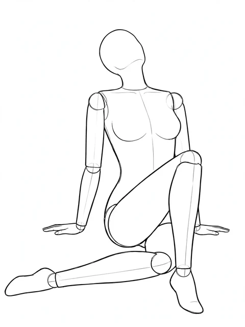

# 角色创作库
### 让想象有形，让角色有据可循。

一个持续更新的中文角色视觉参考与创作网站。为角色设计、绘画练习、影视美术和 AI 创作整理人物、发型、衣装、妆容与动作参考；先看图、挑细节，再把喜欢的元素组合成自己的角色。

**[进入网站 ↗](https://62656456.github.io/character-reference-library/)** · [探索图库](https://62656456.github.io/character-reference-library/#view=gallery) · [角色工作台](https://62656456.github.io/character-reference-library/#view=composer) · [在线上传](https://character-reference-community-62656456.eager-rain-5354.chatgpt.site/?tab=upload) · [支持与交流](https://62656456.github.io/character-reference-library/#view=support)

<table>
  <tr>
    <td align="center"></td>
    <td align="center"></td>
    <td align="center"></td>
  </tr>
  <tr><td align="center">人物的五官与气质</td><td align="center">衣装的结构与材质</td><td align="center">线稿中的动作与重心</td></tr>
</table>

## 当前公开内容

**3363 个参考条目，3844 张实际原图，11 个一级分类。** 多视角动作按“1 组动作”计为一个条目；预览副本和页面装饰不重复计数。

其中，开放动作线稿为 **147 组、628 个实际视角**：71 组单人线稿、66 组半身线稿、10 组双人线稿。每组只显示实际提供的正面、斜侧、侧面、俯视或仰视，不假设每组都有五个视角。卡片和详情可以切换视角，下载对应当前选择的原图。

本轮已同步当前入库的全部 3363 个条目。后续素材仍在继续制作，网站不定期更新，以页面实际展示为准。

| 人物与表现 | 发型与妆造 | 衣装与细节 |
| --- | --- | --- |
| 人像脸型 | 现代发型 | 服装设计 |
| 动作与体态 | 古风发髻 | 配饰设计 |
| 表情与神态（含微动作） | 妆容设计 | 首饰设计 |
| 气质造型 | 肤色参考 | |

## 查找、收藏与比较

- 按分类、分组、名称、关键词或编号查找；长分组列表可以直接搜索，已选条件可以逐项移除。
- 图库以大小错落的排布保留图片完整比例；点开查看原图，选 2–3 张并排比较。
- 收藏喜欢的素材，在当前浏览器继续挑选与搭配。
- 自制图片保留实际生成提示词；开放线稿提供动作使用描述，来源与许可分别保留，不冒称为本站生成作品。

## 一个工作台，两种创作方式

**组合角色**：选择人物、五官、发型、妆造、衣装、配饰与姿势，再整理为完整角色。照片预览支持自然发色、彩虹或棉花糖渐变，也能自定义多色点、位置和方向；光色调整作用于同一张照片，保留发丝明暗层次。需要观察真实立体投影时，可展开 3D 布光检查。

**制作单项素材**：按固定的类别母版制作一款发型、一套衣装、一种妆容或其他单项参考，区分固定背景与构图，以及本次允许变化的内容。

两种方式都提供完整、可编辑的生成描述。组合角色保留两版方案：

- **无参考图版**：把外貌、造型与动作写成完整文字，可直接用于文生图。
- **配参考图版**：保留相同的具体描述，通常配人物、发型与服装三张核心参考；选用线稿动作后，可将当前视角作为第 4 张参考图。

选择双人动作时，人物 A 沿用当前脸型、发型和衣装，人物 B 使用独立文字设定，最终生成恰好两位成年人同框。手动编辑的提示词不会因换一个参数就被覆盖。

当前照片即时调整的是发色与光色；脸型、发型结构、妆造、衣装与姿势需要生成新图后融合，不是实时三维捏脸。照片光色预览也不等同于重建照片的三维光照。

浏览已有图片与本地调色不需要生图密钥。生成新图片使用访问者自己配置的图片服务与额度，只有明确点击生成才发送请求；密钥只保留在当前页面内存，不进入图片仓库。

## 提示词灵感

[提示词灵感页](https://62656456.github.io/character-reference-library/#view=prompts)独立整理 **1489 篇图文记录与 2640 张来源展示图**，不计入上面的角色素材数量。可按主题、模型与关键词查找，查看多张配图、复制提示词、收藏记录或导出筛选结果。

来源作者、模型、许可和来源链接分别保留；源库记录的点赞量属于历史快照，不是实时排名。外部作品不标作本站原创，也不适用本站自制素材的署名规则。

收集来源为 [MeiGen 热门图片提示词](https://github.com/jau123/nanobanana-trending-prompts)与 [Awesome GPT Image 中文提示词](https://github.com/cccyyywqq/awesome-gpt-image-prompts-zh)；原帖作者、源库说明及许可入口保留在每篇详情中。

## 在线上传与运营

[在线社区](https://character-reference-community-62656456.eager-rain-5354.chatgpt.site)提供多图上传、逐项填写资料、失败项重试和个人投稿管理。上传时保留标题、分类、标签、实际提示词、创作者署名、来源与使用条件；普通投稿经审核后公开。

账户使用 **ChatGPT 平台统一认证**。可在平台登录页选择其提供的 Google、Apple 或邮箱方式；本站不另建一套独立的第三方账户系统。

站主可在[运营后台](https://character-reference-community-62656456.eager-rain-5354.chatgpt.site/?tab=admin)审核投稿、编辑素材资料、发布或下架素材、批量操作、导入与导出元数据，并查看使用统计与操作日志。管理功能有权限控制，普通账号只管理自己的投稿。

## Agent 调用技能

[打开通用 Agent Skill](skills/character-reference-library/SKILL.md) · [查看助手脚本](skills/character-reference-library/scripts/atlas.py)

技能用于查找人物、发型、服装、表情和动作，整理完整文字与明确的参考图职责，并下载本次选定的图片。采用标准 `SKILL.md`；支持该格式的宿主可安装技能文件夹，其他能读取 Markdown 与 HTTP 数据的 Agent 也可按说明使用。可选助手脚本只需 Python 3.9+，没有第三方运行依赖，无需克隆全部图库图片。

让 Agent 读取：[SKILL.md 原文](https://raw.githubusercontent.com/62656456/character-reference-library/main/skills/character-reference-library/SKILL.md)，再说明你想创作的角色。技能不会自行收费或提供站主密钥；实际生图使用该 Agent 的图像工具或使用者自行配置的 API。素材使用范围仍遵循每个条目及 [图片使用说明](ASSET-LICENSE.md)。

## 支持与交流

如果这个图库帮到了你，欢迎自愿打赏，支持它继续更新。打赏完全自愿，不影响浏览、技能调用、组合和导出，也不替代图片使用授权。

[打开支持与交流页](https://62656456.github.io/character-reference-library/#view=support)可切换微信、支付宝，并查看独立的添加微信入口，交流 AIGC 创作与技术。

## 来源与使用规则

使用本站自制素材，应事先取得授权，或按条目要求清晰注明 **「角色创作库 @62656456」及对应素材页面链接**。无法保留署名时，请先联系站主。商用合作请提供素材编号、项目与用途；告知不替代具体用途所需的授权。未经另行书面授权，不得去除来源冒充原创、批量镜像、打包转售或作为独立素材库再分发。

开放线稿标注 **「开放线稿 · CC0」**，保留其原有开放许可，不套用本站自制素材的署名条件。投稿与其他外部参考依其条目标注的原作者、来源和许可使用，本站不代替第三方授予权利。详情见[图片使用说明](ASSET-LICENSE.md)。

古风、时代和地域名称用于创作方向与目录组织，不承诺历史复原，也不代表某个人群只有一种外貌。表情与微动作是静态表演参考，不用于情绪诊断或科学标定。

## 仓库公开范围

本仓库公开参考图片、使用说明、Agent 调用技能及必要的发布配置。公开技能目录是明确提供给 Agent 读取与调用的独立入口。网站源码、完整生产数据、社区服务实现、账户资料及私人联系记录另行保存。正常浏览时发送给访客的页面文件和展示信息仍可被读取；源码私有不等于阻止复制公开页面，也不追溯撤回此前已合法取得的许可。

---

由 [62656456](https://github.com/62656456) 维护 · 不定期更新
