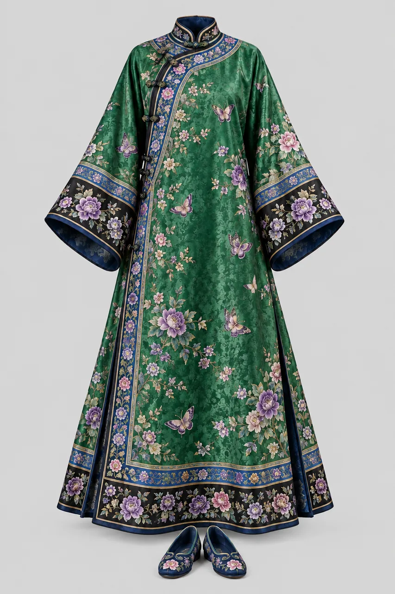
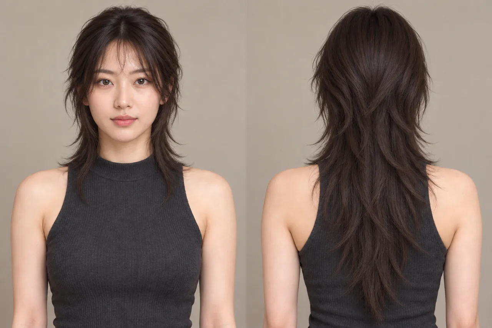
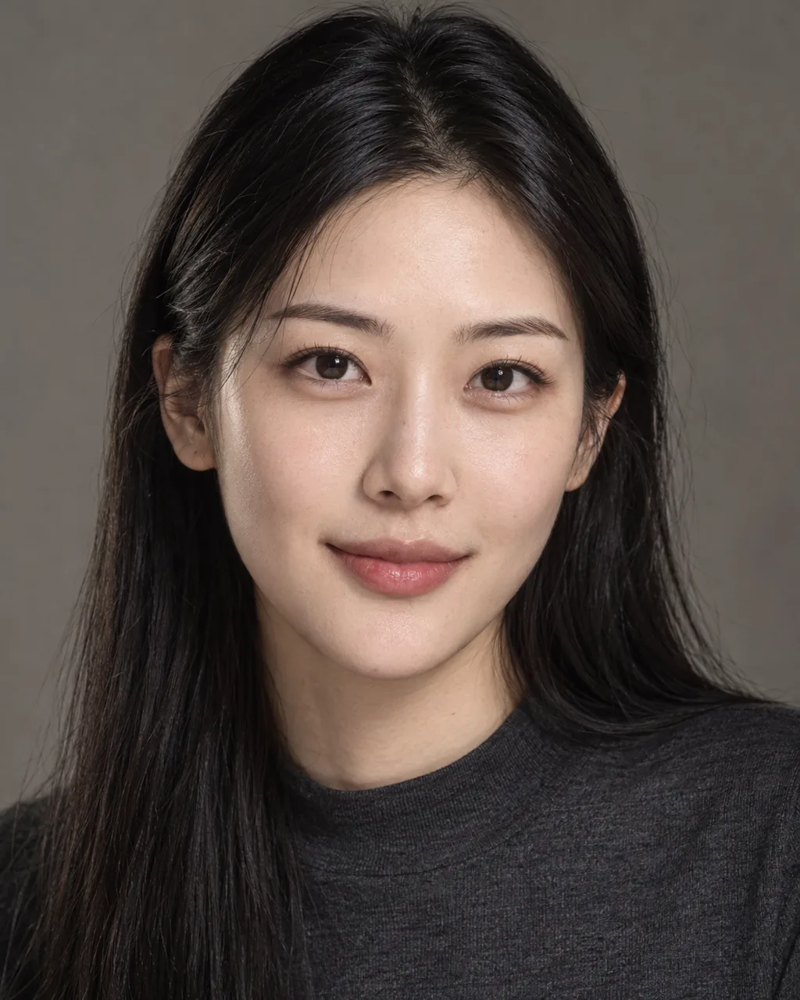

# 角色创作库
### 让想象有形，让角色有据可循。

一个持续更新的中文角色视觉参考网站。为角色设计、绘画练习、影视美术和 AI 创作整理人物、发型、衣装、妆容与表演参考；先看图、挑细节，再把喜欢的元素组合成自己的角色。

**[进入网站 ↗](https://62656456.github.io/character-reference-library/)** · [探索全部图片](https://62656456.github.io/character-reference-library/#view=gallery) · [组合角色](https://62656456.github.io/character-reference-library/#view=composer) · [支持与交流](https://62656456.github.io/character-reference-library/#view=support)

<table>
  <tr>
    <td align="center"></td>
    <td align="center"></td>
    <td align="center"></td>
  </tr>
  <tr><td align="center">看衣装的结构与材质</td><td align="center">看发型的轮廓与层次</td><td align="center">看人物的五官与气质</td></tr>
</table>

## 可以在这里做什么

- **找参考**：按分类、分组、名称、关键词或编号搜索；人物支持已有脸型、肤色和气质标签筛选。
- **细看与比较**：打开完整原图，收藏喜欢的素材，选 2–3 张并排观察差别。
- **了解如何生成**：查看并复制每张图片对应的实际生成提示词，原始提示词与组合描述分别保留。
- **搭配自己的角色**：选择人物、发型、衣装、体态、神态、妆容、配饰和首饰，自动整理两版完整提示词。
- **按自己的方式出图**：无参考图版可直接文生图；有参考图版保留完整描述，并搭配人物、发型、服装三张核心参考。两版都能修改、复制或提交生成。

浏览、收藏和下载已有图片不需要 API 密钥。生成新图片时使用访问者自己配置的图片服务与额度，只有明确点击生成才会发起请求；密钥只保留在当前页面内存。

## 12 类角色参考

| 形象与表演 | 发型与妆造 | 衣装与细节 |
| --- | --- | --- |
| 人像脸型 | 现代发型 | 服装设计 |
| 身材体态 | 古风发髻与发饰 | 配饰设计 |
| 表情神态 | 妆容设计 | 首饰设计 |
| 面部微动作 | 肤色参考 | 气质造型 |

**当前公开版本：1548 张独立参考原图。** 原图位于 `media/originals/`，预览位于 `media/previews/`。页面装饰图、预览副本和同图派生文件不重复计入素材数量。图库不定期更新，以网站实际展示为准。

截至 **2026 年 11 月 4 日**，本地版本已整理 **2932 张图片**，其中 **1384 张尚未同步到公开版本**。本地数量与网站已上线数量分别统计。

## 角色工作台

从人物到光线，在同一个工作台继续创作：

1. 选择人物、发型、妆造、衣装和姿势参考，微调五官、年龄、肤色与造型方向。
2. 尝试自然发色，或使用彩虹、棉花糖等渐变；也可以自己添加色点、调整位置与渐变方向。
3. 在同一张照片上比较发色与光色，保留发丝的明暗层次；需要观察立体投影时，展开 3D 布光检查。
4. 整理无参考图版或配参考图版提示词，分别编辑、复制或生成完整角色。

图库采用大小错落的排布；分组可以直接搜索，已选条件可以单独移除。这次更新同时加入 **16 张多样人物、16 套当代时装和 16 张动作姿势**。

照片预览即时调整的是发色与光色。脸型、发型结构、妆造、衣装与姿势需生成新图后融合，不是实时三维捏脸；照片光色预览也不等同于重建照片的三维光照。

## 支持与交流

如果这个图库对你有帮助，欢迎自愿支持它继续更新；也欢迎添加微信，交流 AIGC 行业的未来、AI 创作与技术实践。网站的[支持与交流页](https://62656456.github.io/character-reference-library/#view=support)分别提供自愿打赏和添加微信的二维码，可放大查看。

打赏完全自愿，不影响浏览使用，也不替代图片的使用授权。

## 图片使用与仓库边界

本仓库公开图片、图片使用说明及必要的发布配置。网站源码、制作记录、完整生产数据和社区服务实现另行私有保存；账户与私人联系记录不在此仓库。

图片**没有统一套用 MIT、CC 或无条件商用许可**。请先阅读[图片使用说明](ASSET-LICENSE.md)，遵守对应素材的来源与使用范围；本站自有图片的商用合作，请通过站内交流入口提供素材编号、项目与用途，逐项确认。投稿者和上游权利人保留各自权利。

古风、时代和地域名称用于创作方向与目录组织，不承诺历史复原，也不代表某个人群只有一种外貌。表情和微动作是静态表演参考，不用于情绪诊断或科学标定。

公开页面向访客展示的内容仍可被读取。源码私有保存不等于禁止截图、复制公开内容，也不追溯撤回此前已合法取得的许可。

---

由 [62656456](https://github.com/62656456) 维护 · 持续更新
